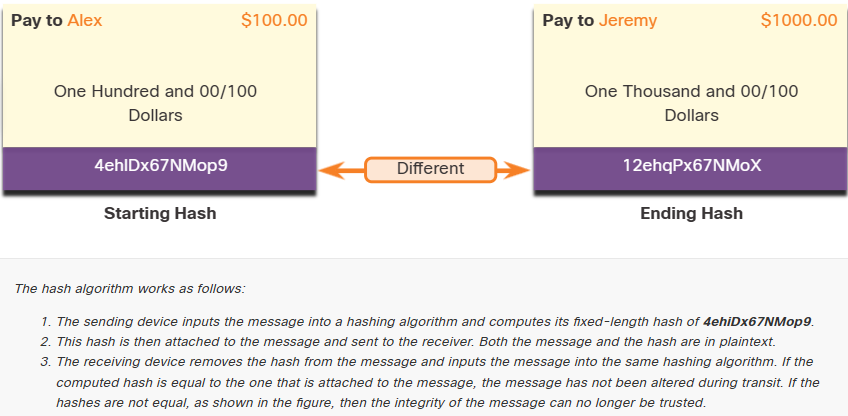
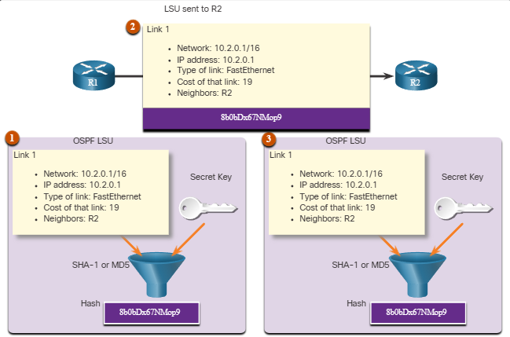
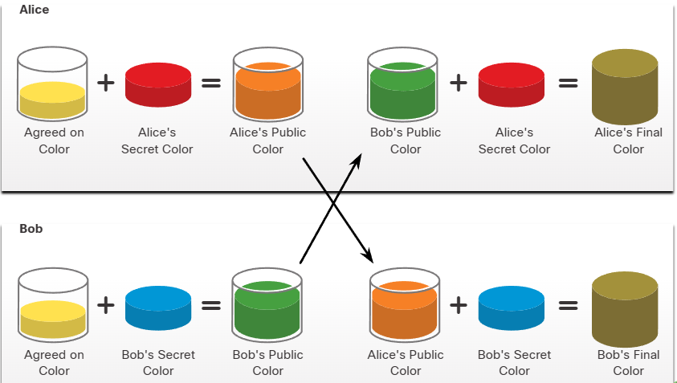

# Cryptography

## Securing Communications
1. Data Integrity
    * Guarantees that the message was not altered. Any changes to data in transit will be detected. Integrity is ensured by implementing either of the Secure Hash Algorithms (SHA-2 or SHA-3).
    * The MD5 message digest algorithm is still widely in use but it is inherently insecure and creates vulnerabilities in a network. The use of MD5 should be avoided.
2. Origin Authentication
    * Guarantees that the message is not a forgery and does actually come from whom it states.
    * Many modern networks ensure authentication with protocols, such as hash message authentication code (HMAC).
3. Data Confidentiality
    * Guarantees that only authorized users can read the message. If the message is intercepted, it cannot be deciphered within a reasonable amount of time. 
    * Data confidentiality is implemented using symmetric and asymmetric encryption algorithms.
4. Data Non-Repudiation
    * Guarantees that the sender cannot repudiate, or refute, the validity of a message sent. 
    * Nonrepudiation relies on the fact that only the sender has the unique characteristics or signature for how that message is treated.

## Data Integrity
* Has functions are used to ensure the integrity of a message. They guarantee that message data has not changed accidentally.

## Hash Functions
1. MD5 with 128-bit Digest
    * Developed by Ron Rivest and used in a variety of internet applications, MD5 is a one-way function that produces a 128-bit hashed message.
    * MD5 is considered to be a legacy algorithm and should be avoided and used only when no better alternatives are available.
    * It is recommended that `SHA-2` or `SHA-3` be used instead.
2. SHA Hashing Algorithm
    * Developed by the U.S. National Security Agency (NSA) in 1995. It is very similar to the MD5 hash functions. Several versions exist. 
    * SHA-1 creates a 160-bit hashed message and is slightly slower than MD5. SHA-1 has known flaws and is a legacy algorithm.
3. SHA-2
    * Developed by the NSA. It includes SHA-224 (224 bit), SHA-256 (256 bit), SHA-384 (384 bit), and SHA-512 (512 bit). If you are using SHA-2, then the SHA-256, SHA-384, and SHA-512 algorithms should be used whenever possible.
4. SHA-3
    * SHA-3 is the newest hashing algorithm and was introduced by NIST as an alternative and eventual replacement for the SHA-2 family of hashing algorithms.
    * SHA-3 includes SHA3-224 (224 bit), SHA3-256 (256 bit), SHA3-384 (384 bit), and SHA3-512 (512 bit).
    * The SHA-3 family are next-generation algorithms and should be used whenever possible.

*Hashing is vulnerable to man-in-the-middle attacks as the threat actor can intercept the message, change it, recalculate the hash, and append it to message.*

## Origin Authentication
1. HMAC Hashing Algorithm
    * HMAC is calculated using any cryptographic algorithm that combines a cryptographic hash function with a secret key.
    * Both the sender and the receiver know the secret key, this defeats man-in-the-middle attacks and provides authentication of the data origin.
2. Creating the HMAC value
    * The sending device inputs data into the hashing algorithm and calculates the fixed-length HMAC digest.
3. Verifying the HMAC value
    * In the figure, the receiving device removes the digest from the message and uses the plaintext message with its secret key as input into the same hashing function. 
    * If the digest that is calculated by the receiving device is equal to the digest that was sent, the message has not been altered. 
    * Additionally, the origin of the message is authenticated because only the sender possesses a copy of the shared secret key. The HMAC function has ensured the authenticity of the message.
4. Cisco Router HMAC example
    * The figure shows how HMACs are used by Cisco routers that are configured to use Open Shortest Path First (OSPF) routing authentication.

R1 is sending a link state update (LSU) regarding a route to network 10.2.0.0/16:

1. R1 calculates the hash value using the LSU message and the secret key.
2. The resulting hash value is sent with the LSU to R2.
3. R2 calculates the hash value using the LSU and its secret key. R2 accepts the update if the hash values match. If they do not match, R2 discards the update.

## Data Confidentiality
* Symmetric encryption algorithms such as Data Encryption Standard (DES), 3DES, and Advanced Encryption Standard (AES) are based on the premise that each communicating party knows the pre-shared key. 
* Data confidentiality can also be ensured using asymmetric algorithms, including Rivest, Shamir, and Adleman (RSA) and the public key infrastructure (PKI).

*DES is a legacy algorithm and should not be used. 3DES should be avoided if possible.*

**Symmetric Encryption**
* Use the same key to encrypt and decrypt data.
* Key lengths are short (40 bits - 256 bits).
* Faster than asymmetric encryption.
* Commonly used for encrypting bulk data such as in VPN traffic.

**Asymmetric Encryption**
* Uses different keys to encrypt and decrypt data.
* Key lengths are long (512 bits - 4096 bits).
* Computationally taxing therefore slower than symmetric encryption.
* Commonly used for quick data transactions such as HTTPS when accessing your bank data.

## Asymmetric Encryption
* Uses the same pre-shared key to encrypt and decrypt data.
* A pre-shared key, also called a *secret key*, is known by the sender and receiver before any encrypted communications can take place.

*In short, both the receiver and the sender have the same exact key to encrypt/decrypt the message.*

**Block ciphers**
* Encrypt data in fixed-sized blocks. The blocks are usually 64-bit or 128-bit. Padding is added if the plaintext data length is not a multiple of 8 to make a complete block.
* *Examples:* DES and AES.

**Stream ciphers**
* examples include: RC4 and SEAL.

Most encruption keys are between 112 and 256 bits. To ensure that the encryption is safe, use a minimum key length of 128 bits. Use longer keys for more secure communications.

1. Data Encryption Standard (DES)  
    * This is a legacy symmetric encryption algorithm. It uses a short key length that makes it insecure for most current uses.  
2. 3DES (Triple DES)  
    * The is the replacement for DES and repeats the DES algorithm process three times. It should be avoided if possible as it is scheduled to be retired in 2023. If implemented, use very short key lifetimes.
3. Advanced Encryption Standard (AES)
    * AES is a secure and more efficient algorithm than 3DES. It is a popular and recommended symmetric encryption algorithm. It offers nine combinations of key and block length by using a variable key length of 128-, 192-, or 256-bit key to encrypt data blocks that are 128, 192, or 256 bits long.
4. Software- Optimized Encryption Algorithm (SEAL)      * SEAL is a faster alternative symmetric encryption algorithm to DES, 3DES, and AES. It uses a 160-bit encryption key and has a lower impact on the CPU compared to other software-based algorithms. 
5. Rivest ciphers (RC) series algorithms
    * This algorithm was developed by Ron Rivest. Several variations have been developed, but RC4 is the most prevalent in use. RC4 is a cipher that was used to secure web traffic. It has been found to have multiple vulnerabilities which have made it insecure. RC4 should not be used.

## Asymmetric Encrption
* Asymmetric algorithms, also called public-key algorithms, are designed so that the key that is used for encryption is different from the key that is used for decryption, as shown in the figure. The decryption key cannot, in any reasonable amount of time, be calculated from the encryption key and vice versa. 
* Asymmetric algorithms use a public key and a private key. Both keys are capable of the encryption process, but the complementary paired key is required for decryption. The process is also reversible. Data encrypted with the public key requires the private key to decrypt. Asymmetric algorithms achieve confidentiality, authentication, and integrity by using this process.

Examples of protocols that use asymmetric key algorithms include:

* **Internet Key Exchange (IKE)** - This is a fundamental component of IPsec VPNs.
* **Secure Socket Layer (SSL)** - This is now implemented as IETF standard Transport Layer Security (TLS).
* **Secure Shell (SSH)** - This protocol provides a secure remote access connection to network devices.
* **Pretty Good Privacy (PGP)** - This computer program provides cryptographic privacy and authentication. It is often used to increase the security of email communications.

1. Diffie-Hellman(DH)
    * The Diffie-Hellman algorithm allows two parties to agree on a key that they can use to encrypt messages they want to send to each other. The security of this algorithm depends on the assumption that it is easy to raise a number to a certain power, but difficult to compute which power was used given the number and the outcome.
2. Digital Signature Standard (DSS) and Digital SignatureAlgorithm (DSA)
    * DSS specifies DSA as the algorithm for digital signatures. DSA is a public key algorithm based on the ElGamal signature scheme. Signature creation speed is similar to RSA, but is 10 to 40 times slower for verification.
3. Rivest, Shamir, and Adleman encryption algorithms (RSA)
    * RSA is for public-key cryptography that is based on the current difficulty of factoring very large numbers. It is the first algorithm known to be suitable for signing as well as encryption. It is widely used in electronic commerce protocols and is believed to be secure given sufficiently long keys and the use of up-to-date implementations.
4. ElGamal
    * An asymmetric key encryption algorithm for public-key cryptography which is based on the Diffie-Hellman key agreement. A disadvantage of the ElGamal system is that the encrypted message becomes very big, about twice the size of the original message and for this reason it is only used for small messages such as secret keys.
5. Elliptic curve techniques
    * Elliptic curve cryptography can be used to adapt many cryptographic algorithms, such as Diffie-Hellman or ElGamal. The main advantage of elliptic curve cryptography is that the keys can be much smaller.

## Diffie-Hellman(DH)
* An asymmetrical mathematical algorithm where two computers generate an identical shared secret key without having communicated before.
* They key is never actually exchanged between the sender and the receiver.

Here are three examples of instances when DH is commonly used:
* Data is exchanged using an IPsec VPN.
* Used when data is exchanged using an SSL or TLS VPN.
* SSH data is exchanged.

1. Agree on a public color — Both people start with yellow.
2. Choose a secret color — Alice chooses red, while Bob chooses blue. Keep these secret.
3. Mix the colors — Alice mixes yellow + red, while Bob mixes yellow + blue.
4. Exchange the mixtures — They publicly exchange their mixed colors.
5. Mix again with your secret color — Alice adds red to Bob’s mixture, while Bob adds blue to Alice’s mixture.
6. Get the same final color — Both arrive at the same secret color combination without revealing their original secret colors.