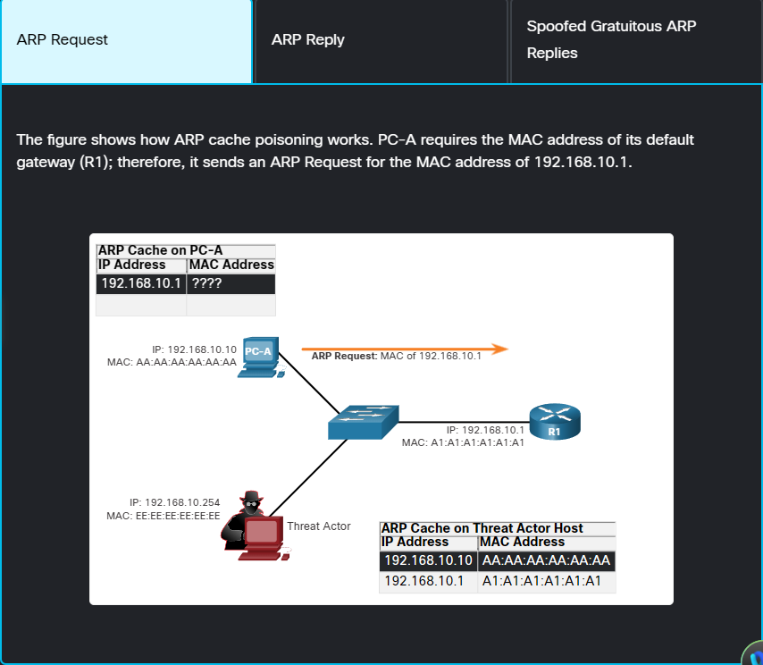
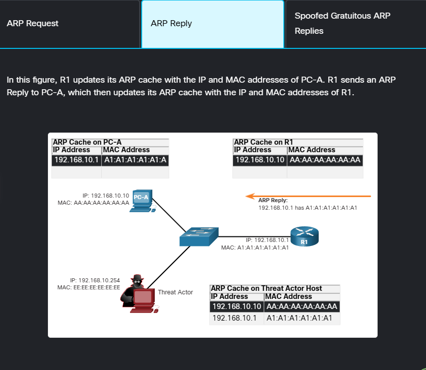
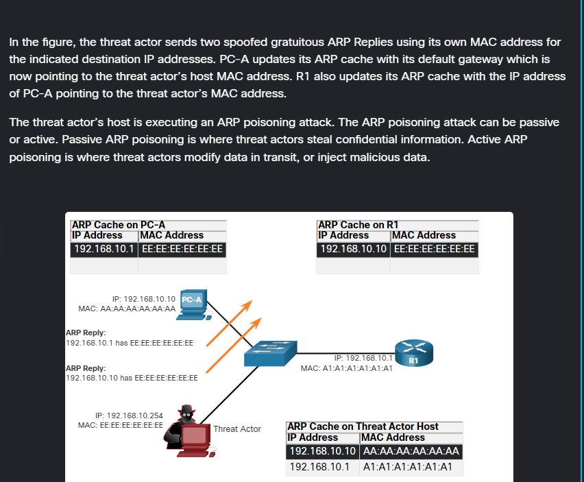

# ARP Vulnerabilities

* Hosts broadcast an ARP Request to other hosts on the segment to determine the MAC address of a host with a particular IP address. All hosts on the subnet receive and process the ARP Request. The host with them atching IP address in the ARP Request sends an ARP Reply.

Any client can send an unsolicitated ARP Reply called a `gratuitous ARP`.
* Done when a device first boots up to inform all other devices on the local network of the new device's MAC address.
* When a host sends a gratuitous ARP, other hosts on the subnet store the MAC address and IP address contained in the gratuitous ARP in their ARP tables.

## ARP Cache Poisoning
* ARP cache poisoning can be used to launch various man-in-the-middle attacks.

 

 

## DNS Attacks
The Domain Name System (DNS) protocol defines an automated service that matches resource names, such as www.cisco.com, with the required numeric network address, such as the IPv4 or IPv6 address. It includes the format for queries, responses, and data and uses resource records (RR) to identify the type of DNS
response.

*Securing DNS is often overlooked. However, it is crucial to the operation of a network and should be secured
accordingly.*

DNS attacks include the following:
* DNS open resolver attacks
* DNS stealth attacks
* DNS domain shadowing attacks
* DNS tunneling attacks

### DNS Open Resolver Attacks
* DNS cache poisoning attacks
    - Threat actors send spoofed, falsified record resource (RR) information to a DNS resolver to redirect users from legitimate sites to malicious sites. DNS cache poisoning attacks can all be used to inform the DNS resolver to use a malicious name server that is providing RR information for malicious activities.

* DNS amplification and reflection attacks
    - Threat actors use DoS or DDoS attacks on DNS open resolvers to increase the volume of attacks and to hide the true source of an attack. Threat actors send DNS messages to the open resolvers using the IP address of a target host. These attacks are possible because the open resolver will respond to queries from anyone asking a question.

* DNS resource utilization attacks
- A DoS attack that consumes the resources of the DNS open resolvers. This DoS attack consumes all the available resources to negatively affect the operations of the DNS open resolver. The impact of this DoS attack may require the DNS open resolver to be rebooted or services to be stopped and restarted.

### DNS Stealth Attacks
* Fast Flux
    - Threat actors use this technique to hide their phishing and malware delivery sites behind a quickly-changing network of compromised DNS hosts. The DNS IP addresses are continuously changed within minutes. Botnets often employ Fast Flux techniques to effectively hide malicious servers from being detected.

* Double IP Flux
    - Threat actors use this technique to rapidly change the hostname to IP address mappings and to also change the authoritative name server. This increases the difficulty of identifying the source of the attack.

* Domain Generation Algorithms
    - Threat actors use this technique in malware to randomly generate domain names that can then be used as rendezvous points to their command and control (C&C) servers.

### DNS Domain Shadowing Attacks
* A threat actor gathers domain account credentials in order to silently create multiple-subs to be used during attacks. These subdomains typically point to malicious servers without alerting the actual owner of the parent domain.

## DNS Tunneling
* Basically chops up small chunks of data from the infilrated root cause, like a malware, to send to the threat actor that passes through firewall. This way the threat actor can still gather data while slipping through the firewall.
* This is why network admins use DNS filters or DNS firewalls.

## DHCP Operations
1. Client broadcasts DHCPDISCOVER to the server.
2. Server then DHCPOFFER to the client as a response
3. Client broadcasts DHCPREQUEST to tell the IP address provided was accepted to the server.
4. Server broadcasts DHCPACK to acknowledge the client's acceptance.

## DHCP Attacks
* DHCP Spoofing Attacks
    - This occurs when a rogue DHCP server is connected to the network and provides false IP configuration parameters to legitimate clients.
1. Wrong default gateway
    * Threat actor provides an invalid gateway, or the IP address of its host to create a MITM attack. This may go entirely undetected as the intruder intercepts the data flow through the network.
2. Wrong DNS server
    * Threat actor provides an incorrect DNS server address pointing the user to a malicious website.
3. Wrong IP address
    * Threat actor provides an invalid IP address, invalid default gateway IP address, or both. The threat actor then creates a DoS attack on the DHCP client.