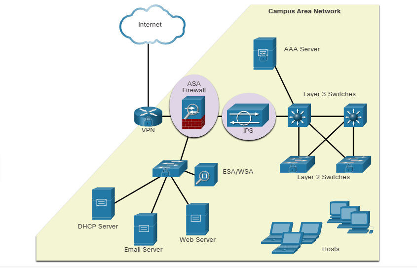
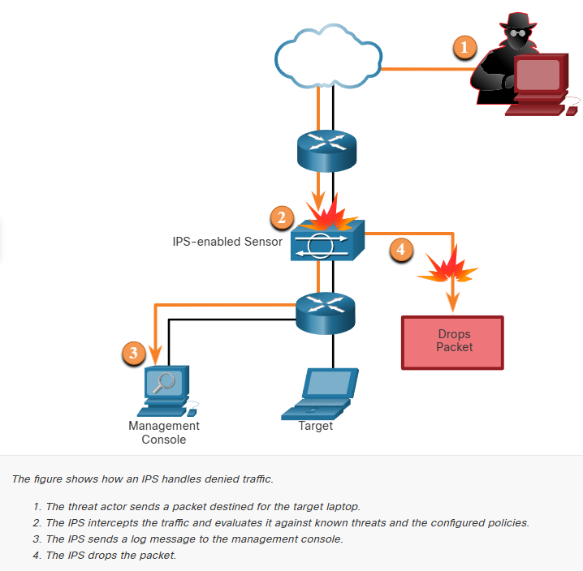
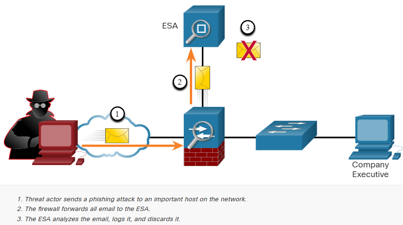
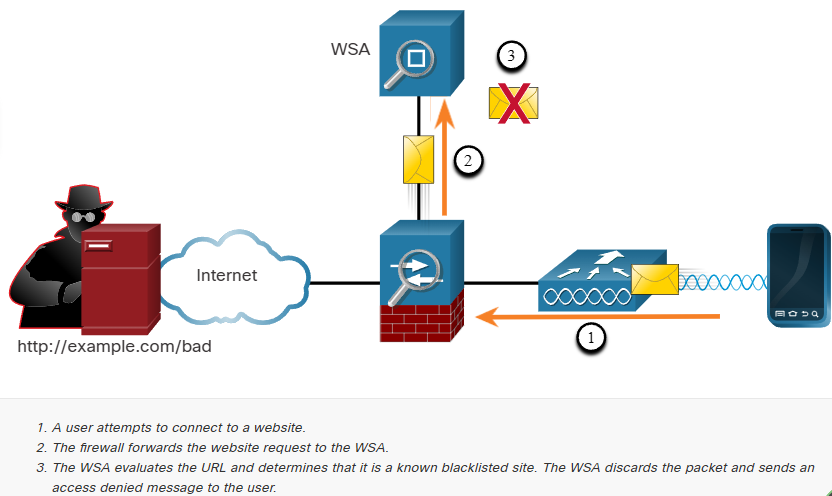

# Network Security Best Practices

## Confidentiality, Integrity, and Availability
* Most organizations follow this security triad.

1. Confidentialty
    * Only authorized individuals, entities, or processes can access sensitive information.
    * May require using cryptographic encryption algorithms such as AES to ecnrypt and decreypt data.
2. Integrity
    * Refers to protecting data from unauthorized alteration.
    * Requires the use of cryptographic hasing algorithms such as Secure Hash Algorithm (SHA).
3. Availability
    * Authorized users must have uninterrupted access to important resources and data.
    * Requires implementing redundant services, gateways, and links.

**Secure Hash Algorithm**
* SHA takes an input (such as a file, message, or network packet) and converts it into a fixed-length string of characters called a hash value or digest.

## The Defense-in-Depth Approach
* Most organizations employ a defense-in-depth approach to security.
* This is also known as *layered approach*.
    * It requires combinations of networking devices and services working together.

1. VPN
    * A router is used to provide secure VPN services with corporate sites and remote access support for remote users using secure encrypted tunnels.
2. ASA Firewall
    * This dedicated device provides stateful firewall services. It ensures that internal traffic can go out and come back, but external traffic cannot initiate connections to inside hosts.
3. IPS
    * An Intrusion Prevention System (IPS) monitors incoming and outgoing traffic looking for malware, network attack signatures, and more. If it recognizes a threat, it can immediately stop it.
4. ESA/WSA
    * The email security appliance (ESA) filters spam and suspicious emails. The web security appliance filters known and suspicious internet malware sites.
5. Authentication, Authorization, and Accounting (AAA) Server
    * This server contains a secure database of who is authorized to access and manage network devices. Network devices authenticate administrative users using this database.

## Firewalls
* A firewall is a system, or group of systems, that enforces an access control policy between networks.

### Firewall Operation:
All firewalls share some common properties:
*  Firewalls are resistant to network attacks.
*  Firewalls are the only transit points between internalcorporate networks and external networks because all traffic flows through the firewall.
*  Firewalls enforce the access control policy.

There are several benefits of using a firewall in a network:
*  They prevent the exposure of sensitive hosts, resources, and applications to untrusted users.
*  They sanitize protocol flow, which prevents the exploitation of protocol flaws.
*  They block malicious data from servers and clients.
*  They reduce security management complexity by off-loading most of the network access control to a few firewalls in the network.

Firewalls also present some limitations:
*  A misconfigured firewall can have serious consequences for the network, such as becoming a single point of failure.
*  The data from many applications cannot be passed through firewalls securely.
*  Users might proactively search for ways around the firewall to receive blocked material, which exposes the network to potential attack.
*  Network performance can slow down.
*  Unauthorized traffic can be tunneled or hidden so that it appears as legitimate traffic through the firewall.

## IPS
* To defend against fast-moving and evolving attacks, a network may need cost-effective detection and prevention systems, such as intursion detection systems (IDS), or the more scalable intrusion prevention system (IPS).

## Content Security Appliances
* Content security appliances include fine-grained control over email and web browsing for an organization's users.

### Cisco Email Security Appliance (ESA)
* The Cisco Email Security Appliance (ESA) is a special device designed to monitor Simple Mail Transfer Protocol (SMTP). 
* The Cisco ESA is constantly updated by real-time feeds from the Cisco Talos, which detects and correlates threats and solutions by using a worldwide database monitoring system.
* This threat intelligence data is pulled by the Cisco ESA every three to five minutes.

### Cisco Web Security Appliance (WSA)
* The Cisco Web Security Appliance (WSA) is a mitigation technology for web-based threats. It helps organizations address the challenges of securing and controlling web traffic.
* The Cisco WSA combines advanced malware protection, application visibility and control, acceptable use policy controls, and reporting.

* Cisco WSA provides complete control over how users access the internet. Certain features and applications, such as chat, messaging, video and audio, can be allowed, restricted with time and bandwidth limits, or blocked, according to the organization's requirements.
* The WSA can perform blacklisting of URLs, URL- filtering, malware scanning, URL categorization, web application filtering, and encryption and decryption of web traffic.

