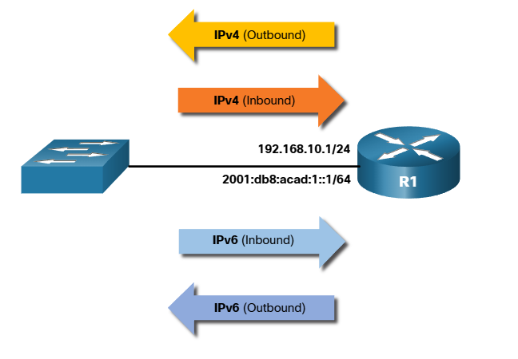
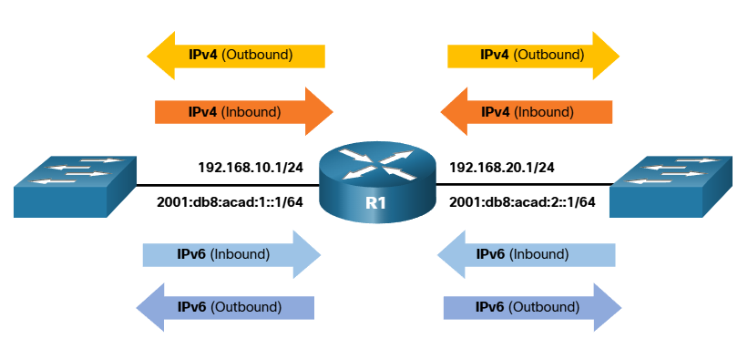

# Guidelines for ACL Creation

## Limited number of ACLs per interface
* There is a limit on the number of ACLs that can be applied on a router interface.

Specifically, a router interface can have:
* One outbound IPv4 ACL
* One inbound IPv4 ACL
* One inbound IPv6 ACL
* One outbound IPv6 ACL

 
*Note: ACLs do not have to be configured in both directions. The number of ACLs and their direction applied to the interface will depend on the security policy of the organization.*

## ACL Best Practices
* This presents guidelines that form the basis of an ACL best practices list.

|Guideline |Benefit |
| --- | --- |
| Base ACLs on the organizational security policies. |This will ensure you implement organizational security guidelines. |
|Write out what you want the ACL to do. |This will help you avoid inadvertently creating potential access problems. |
|Use a text editor to create, edit, and save all of your ACLs. |This will help you create a library of reusable ACLs. |
|Document the ACLs using the remark command. |This will help you (and others) understand the purpose of an ACE. |
|Test the ACLs on a development network before implementing them on a production network. |This will help you avoid costly errors. |

*The `remark` command is used to add descriptions and let administrators document what the purpose of the ACE command is.*