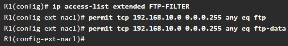
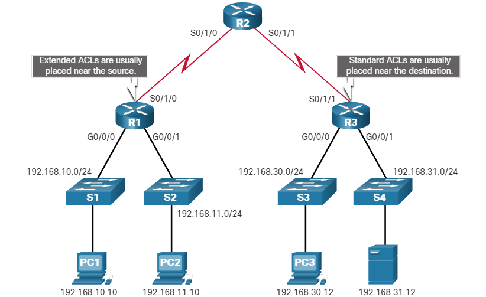
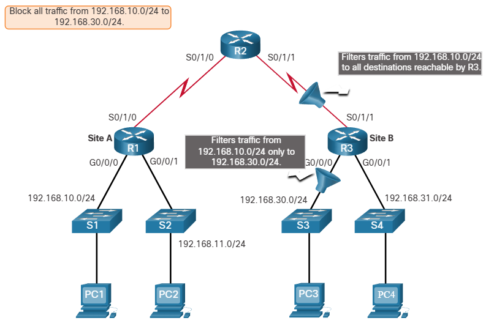
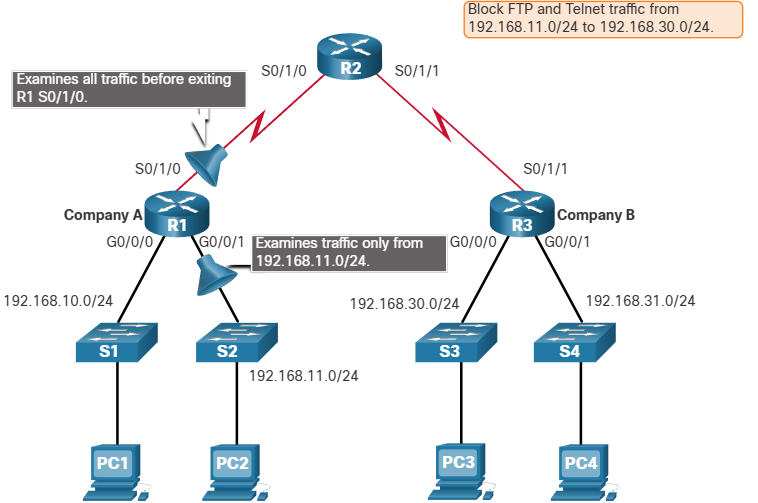

# Types of IPv4 ACLs

## Standard and Extended ACLs
There are two types of IPv4 ACLs:
* **Standard ACLs** - These permit or deny packets based only on the source IPv4 address.
* **Extended ACLs** - These permit or deny packets based on the source IPv4 address and destination IPv4 address, protocol type, source and destination TCP or UDP ports and more.

### The following is a standard ALC command:
* `R1(config)# access-list 10 permit 192.168.10.0 0.0.0.255`
 ACL 10 permits hosts on the source network 192.168.10.0/24.
Because of the implied "deny any" at the end, all traffic except for traffic coming from the 192.168.10.0/24 network is blocked with this ACL.

An extended ACL 100 permits traffic originating from any host on the 192.168.10.0/24 network to any IPv4 network if the destination port is 80(HTTP).
* `R1(config)# access-list 100 permit tcp 192.168.10.0 0.0.0.255 any eq www`

## Numbered and Named ACLs
### Numbered ACLs
|Standard ACLs |Extended ACLs |
| --- | --- |
|1 to 99 |100 to 199 |
|1300 to 1999 |2000 to 2699 |

### Named ACLs
* Is the preferred method to use when configuring ACLs. Specifically, standard and extended ACLs can be named to provide information about the purpose of the ACL.

The ip access-list global configuration command is used to create a named ACL, as shown in the following example:

## Where to Place ACLs
Every ACL should be placed where it has the greatest impact on efficiency.
 

* *Extended ACLs* should be located as close as possible to the source of the traffic to be filtered. This way, undesirable traffic is denied close to the source network without crossing the network infrastructure.
* Standard ACLs should be located close to the destination as possible. If a standard ACL was placed at the source of the raffic, the `permit` or `deny` will occur based on the given source address no matter where the traffic is destined.

### Factors influencing ACL placement
1. The extent of organizational control
    * Placement of the ACL can depend on whether or not the organization has control of both the source and destination networks.
2. Bandwidth of the networks involved
    * It may be desirable to filter unwanted traffic at the source to prevent transmission of andwidth-consuming traffic.
3. Ease of configuration
    * It may be easier to implement an ACL at the destination, but traffic will use bandwidth unnecessarily.
    * An extended ACL could be used on each router where the traffic originated. This would save bandwidth by filtering the traffic at the source, but it would require creating extended ACLs on multiple routers.

## Standard ACL Placement Example
In this figure, the administrator wants to prevent traffic originating in the 192.168.10.0/24 network from reaching the 192.168.30.0/24 network.

* **R3 S0/1/1 interface (inbound)** - The standard ACL can be applied inbound on the R3 S0/1/1 interface to deny traffic from. 10 network. However, it would also filter. 10 traffic to the 192.168.31.0/24 (.31 in this example) network. Therefore, the standard ACL should not be applied to this interface.
* **R3 G0/0 interface (outbound)** - The standard ACL can be applied outbound on the R3 G0/0/0 interface. This will not affect other networks that are reachable by R3. Packets from .10 network will still be able to reach the .31 network. This is the best interface to place the standard ACL to meet the traffic requirements.

## Extended ACL Placement Example
In the figure, for example, Company A wants to deny Telnet and FTP traffic to Company B's 192.168.30.0/24 network from their 192.168.11.0/24 network while permitting all other traffic.

* **R1 S0/1/0 interface (outbound)** - The extended ACL can be applied outbound on the S0/1/0 interface. However, this solution will process all packets leaving R1 including packets from 192.168.10.0/24.
* **R1 G0/0/1 interface (inbound**) - The extended ACL can be applied inbound on the G0/0/1 and only packets from the 192.168.11.0/24 network are subject to ACL processing on R1. Because the filter is to be limited to only those packets leaving the 192.168.11.0/24 network, applying the extended ACL to G0/1 is the best solution.