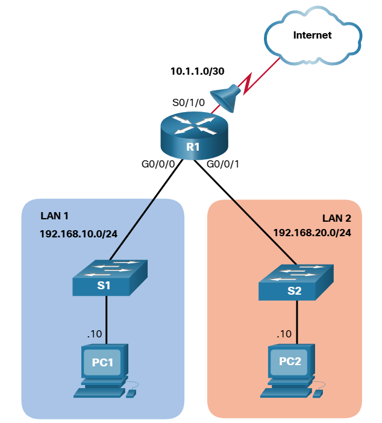
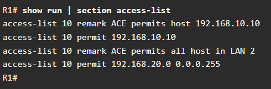
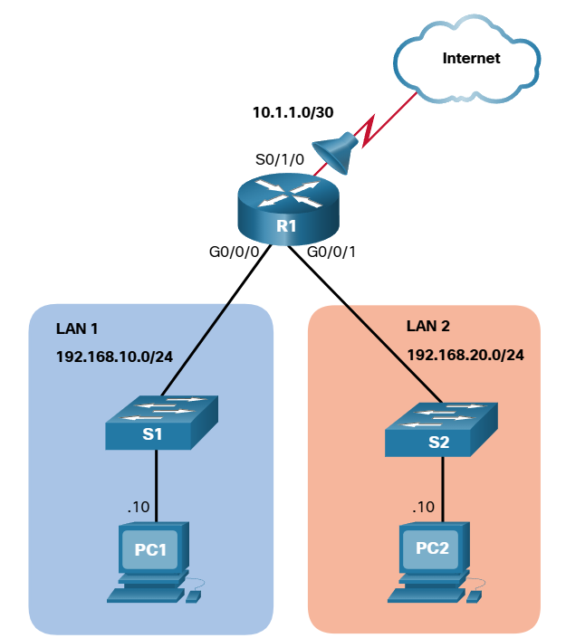

# Configure Standard IPv4 ACLs

## Numbered Standard IPv4 ACL Syntax
To create a numbered standard ACL, use the following global configuration command:
* `Router(config)# access-list access-list-number {deny | permit | remark text} source [source-wildcard] [1og]`

Use the `no access-list` *access-list-number* global configuration command to remove a numbered standard ACL.

This provides a detailed explanation of the syntax for a standard ACL.
1. acess-list-number
    * This is the decimal number of the ACL.
    * Standard ACL number range is 1 to 99 or 1300 to 1999.
2. deny
    * This denies access if the condition is matched.
3. permit
    * This permits access if the condition is matched.
4. remark text
    * (Optional) This adds a text entry for documentation purposes.
    * Each remark is limited to 100 characters.
5. source
    * This identifies the source network or host address to filter.
    * Use the any keyword to specify all networks.
    * Use the host ip-address keyword or simply enter an ip-address (without the host keyword) to identify a specific IP address.
6. source-wildcard
* (Optional) This is a 32-bit wildcard mask that is applied to the source . If omitted, a default 0.0.0.0 mask is assumed.
7. 1og
    * (Optional) This keyword generates and sends an informational message whenever the ACE is matched.
    * Message includes ACL number, matched condition (i.e., permitted or denied), source address, and number of packets.
    * This message is generated for the first matched packet.
    * This keyword should only be implemented for troubleshooting or security reasons.

## Named Standard IPv4 ACL Syntax
Naming an ACL makes it easier to understand its function. To create a named standard ACL, use the following global configuration commad:
* `Router(config)# ip access-list standard access-list-name`

*Note: ACL names are alphanumeric, case sensitive, and must be unique.*

## Apply a standard IPv4 ACL
* After a standard IPv4 ACL is configured, it must be linked to an interface or feature.
* The following command can be used to bind a numbered or named standard IPv4 ACL to an interface:
    - `Router(config-if) # ip access-group {access-list-number access-list-name} {in | out}`

## Numbered Standard IPv4 ACL Example

Assume only PC1 is allowed out to the internet. To enable this policy, a standard ACL ACE could be applied outbound on S0/1/0, as shown in the figure.
1. `R1(config)# access-list 10 remark ACE permits ONLY host 192.168.10.10 to the internet`
2. `R1(config)# access-list 10 permit host 192.168.10.10`
3. `R1(config)# do show access-lists`
4. Standard IP access list 10
    - 10 permit 192.168.10.10
5. `R1(config)#`

Now assume that a new network policy states that hosts in LAN 2 should also be permitted to the internet.
1. `R1(config)# access-list 10 remark ACE permits all host in LAN 2`
2. `R1(config)# access-list 10 permit 192.168.20.0 0.0.0.255`
3. `R1(config)# do show access-lists`
    * Standard IP access list 10
        - 10 permit 192.168.10.10
        - 20 permit 192.168.20.0, wildcard bits 0.0.0.255
4. `R1(config)#`

Apply ACL 10 outbound on the Serial 0/1/0 interface.
* `R1(config)# interface Serial 0/1/0`
* `R1(config-if)# ip access-group 10 out`
* `R1(config-if)# end`
* `R1#`
 
 
The resulting policy will only permit host 192.168.10.10 and all host from LAN 2 to exit the Serial 0/1/0 interface.

*But using the `show run | section access-list` also displays the remarks statements.*

## Named Standard IPv4 ACL Example

Remove the previously configured named ACL 10, and create a named standard ACL called PERMIT-ACCESSS, as shown here.

* `R1(config)# no access-list 10`
* `R1(config)# ip access-list standard PERMIT-ACCESS`
* `R1(config-std-nacl)# remark ACE permits host 192.168.10.10`
* `R1(config-std-nacl)# permit host 192.168.10.10`
* `R1(config-std-nacl)#`

Now add an ACE permitting only host 192.168.10.10 and another ACE permitting all LAN 2 hosts to the internet.

* `R1(config-std-nacl)# remark ACE permits host 192.168.10.10`
* `R1(config-std-nacl)# permit host 192.168.10.10`
* `R1(config-std-nacl)# remark ACE permits all hosts in LAN 2`
* `R1(config-std-nacl)# permit 192.168.20.0 0.0.0.255`
* `R1(config-std-nacl)# exit`
* `R1(config)#`

Apply the new named ACL outbound to the Serial 0/1/0 interface

* `R1(config)# interface Serial 0/1/0`
* `R1(config-if)# ip access-group PERMIT-ACCESS out`
* `R1(config-if)# end`
* `R1#`

