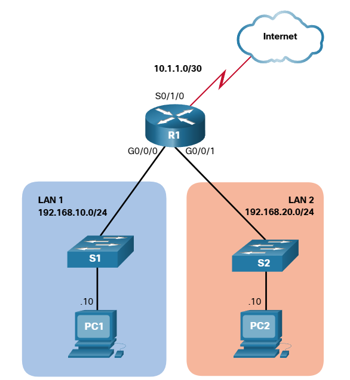

# Secure VTY Ports with a standard IPv4 ACL

## The access-class command
ACLs typically filter incoming or outgoing traffic on an interface. However, an ACL can also be used to secure remote administrative access to a device using the vty lines.

Use the following two steps to secure remote administrative access to the VTY lines:
* Create an ACL to identify which administrative hosts should be allowed remote access.
* Apply the ACL to incoming traffic on the vty lines.

Use the following command to apply an ACL to the vty lines:
```text
R1(config-line)# access-class {access-list-number | access-list-name} { in | out }
```

* The `in` keyword is the most commonly used option to filter incoming vty traffic.
* The `out` parameter filters outgoing vty traffic and is rarely applied.


The following should be considered when configuring access lists on vty lines:
* Both named and numbered access lists can be applied to vty lines.
* Idedntical restrictions should be set on all the vty lines, because a user can attempt to connect to any of them.

## Secure VTY Access Example

<br><br>
The topology in the figure is used to demonstrate how to configure an ACL to filter vty traffic. In this example, only PC1 will be allowed to Telnet in to R1.

*note: Telnet is only used here for demonstration. SSH should be used in production environment.*
<br><br>
To increase secure access, a username and password will be created, and the login local authentication method will be used on the vty lines. The command in the example creates a local database entry for a user ADMIN and password class.

A named standard ACL called ADMIN-HOST is created and identifies PC1. Notice that the deny any has been configured to track the number of times access has been denied.

The vty lines are configured to use the local database for authentication, permit Telnet traffic, and use the ADMIN-HOST ACL to restrict traffic.

```text
R1(config)# username ADMIN secret class
R1(config)# ip access-list standard ADMIN-HOST
R1(config-std-nacl)# remark This ACL secures incoming vty lines
R1(config-std-nacl)# permit 192.168.10.10
R1(config-std-nacl)# deny any
R1(config-std-nacl)# exit
R1(config)# line vty 0 4
R1(config-line)# login local
R1(config-line)# transport input telnet
R1(config-line)# access-class ADMIN-HOST in
R1(config-line)# end
R1#
```

In a production environment, you would set the vty lines to only allow SSH, as shown in the example.
```text
R1(config)# line vty 0 4
R1(config-line)# login local
R1(config-line)# transport input ssh
R1(config-line)# access-class ADMIN-HOST in
R1(config-line)# end
R1#
```

To verify the ACL statistics, issue the `show accessl-list` command.

