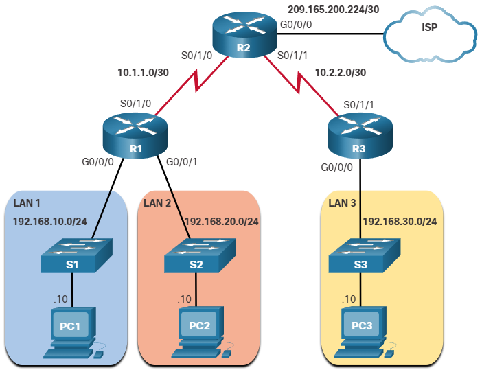
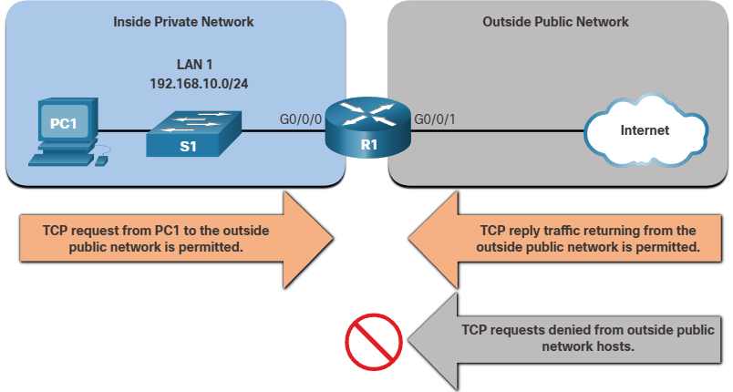
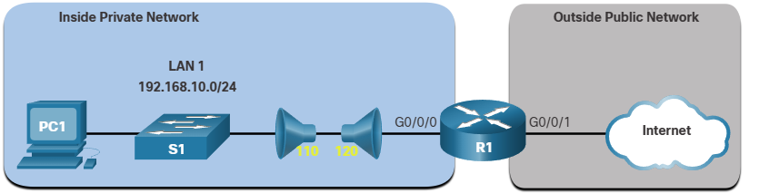
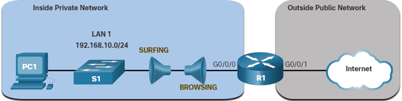
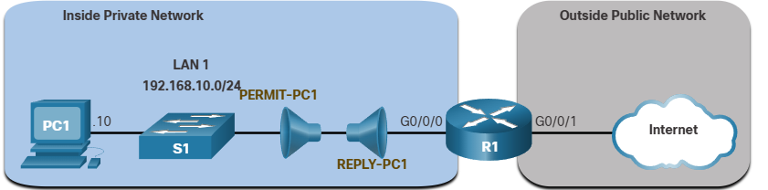

# Extended ACLs
When more precise traffic-filtering control is required, extended IPv4 ACLs can be created.

Extended ACLs are used more often than standard ACLs because they provide a greater degree of control. They can filter on source address, destination address, protocol (i.e., IP, TCP, UDP, ICMP), and port number.

Like standard ACLs, extended ACLs can be created as:
* Numbered Extended ACL - created using the `access-list` *access-list-numbner* global configuration command.
* Named Extended ACL - created using the `ip acess-list extended` *access-list-name*.

## Numbered Extended IPv4 ACL Syntax
To create a numbered extended ACL, use the following global configuration command:

```text
Router(config)# access-list access-list-number {deny | permit | remark text} protocol source source-wildcard [operator {port}] destination destination-wildcard [operator {port}] [established] [log]
```

Use the `no access-list` *access-list-number* global configuration command to remove an extended ACL.

1. `access-list-number`
    * This is the decimal number of the ACL.
    * Extended ACL number range is 100 to 199 and 2000 to 2699.
2. `deny`
    * This denies access if the condition is matched.
3. `permit`
    * This permits access if the condition is matched.
4. `remark text`
    * (Optional) Adds a text entry for documentation purposes.
    * Each remark is limited to 100 characters.
5. `protocol`
    * Name or number of an internet protocol.
    * Common keywords include ip, tcp, udp, and icmp.
    * The ip keyword matches all IP protocols.
6. `source`
    * This identifies the source network or host address to filter.
    * Use the any keyword to specify all networks.
    * Use the host ip-address keyword or simply enter an ip-address (without the host keyword) to identify a specific IP address.
7. `source-wildcard`
    * (Optional) A 32-bit wildcard mask that is applied to the source.
8. `destination`
    * This identifies the destination network or host address to filter.
    * Use the any keyword to specify all networks.
    * Use the host ip-address keyword or ip-address.
9. `destination-wildcard`
    * (Optional) This is a 32-bit wildcard mask that is applied to the destination.
10. `operator`
    * (Optional) This compares source or destination ports.
    * Some operators include It (less than), gt (greater than), eq (equal), and neq (not equal).
11. `port`
    * (Optional) The decimal number or name of a TCP or UDP port.
12. `established`
    * (Optional) For the TCP protocol only.
    * This is a 1st generation firewall feature.
13. `log`
    * (Optional) This keyword generates and sends an informational message whenever the ACE is matched.
    * This message includes ACL number, matched condition (i.e., permitted or denied), source address, and number of packets.
    * This message is generated for the first matched packet.
    * This keyword should only be implemented for troubleshooting or security reasons.

The command to apply an extended IPv4 ACL to an interface is the same as the command used for standard IPv4 ACLs.
```text
Router(config-if)# ip access-group {access-list-number | access-list-name} {in | out}
```

## Protocols and Ports

### Protocol Options
These four protocols are the most popular options.
1. `icmp`
    * Internet Control Message Protocol
2. `ip`
    * Any Internet Protocol
3. `tcp`
    * Transmission Control Protocol
4. `udp` 
    * User Datagram Protocol

*note: use the `?` to get help when entering a complex ACE.*

### Port Keyword Options
Selecting a protocol influences port options. For instance, selecting the:
* **tcp** protocol would provide TCP related port options.
* **udp** protocol would provide UDP specific ports options.
* **icmp** protocol would provide ICMP related ports (i.e., message) options.

These TCP port options are the popular ones:
1. `domain`
    * Domain Name System (53)
2. `ftp`
    * File Transfer Protocol (21)
3. `ftp-data`
    * FTP data connections (20)
4. `pop3`
    * Post Office Protocol v3 (110)
5. `smtp`
    * Simple Mail Transport Protocol (25)
6. `telnet`
    * Telnet (23)
7. `www`
    * World Wide Web (HTTP, 80)

## Protocols and Port Numbers Configuration Examples
Extended ACLs can filter on different port number and port name options. This example configures an extended ACL 100 to filter HTTP traffic. The first ACE uses the www port name. The second ACE uses the port number 80. Both ACEs achieve exactly the same result.

```text
R1(config)# access-list 100 permit tcp any any eq www
R1(config)# ǃor.
R1(config)# access-list 100 permit tcp any any eq 80
```
<br><br>
Configuring the port number is required when there is not a specific protocol name listed such as SSH (port number 22) or an HTTPS (port number 443), as shown in the next example.

```text
R1(config)# access-list 100 permit tcp any any eq 22
R1(config)# access-list 100 permit tcp any any eq 443
R1(config)#
```

## Apply a numbered extended IPv4 ACL

In this example, the ACL permits both HTTP and HTTPS traffic from the 192.168.10.0 network to go to any destination.

Extended ACLs can be applied in various locations. However, they are commonly applied close to the source. Therefore, ACL 110 was applied inbound on the R1 G0/0/0 interface.

```text
R1(config)# access-list 110 permit tcp 192.168.10.0 0.0.0.255 any eq www
R1(config)# access-list 110 permit tcp 192.168.10.0 0.0.0.255 any eq 443
R1(config)# interface g0/0/0
R1(config-if)# ip access-group 110 in
R1(config-if)# exit
R1(config)#
```

## TCP Established Extended ACL
TCP can also perform basic stateful firewall services using the TCP established keyword. The keyword enables inside traffic to exit the inside private network and permits the returning reply traffic to enter the inside private network, as shownin the figure.



However, TCP traffic generated by an outside host and attempting to communicate with an inside host is denied. The `established` keyword can be used to permit only the return HTTP traffic from requested websites, while denying all other traffic.

In the topology, the design for this example shows that ACL 110, which was previously configured, will filter traffic from the inside private network. ACL 120, using the established keyword, will filter traffic coming into the inside private network from the outside public network.



In the example, ACL 120 is configured to only permit returning web traffic to the inside hosts. The new ACL is then applied outbound on the R1 G0/0/0 interface.

```text
R1(config)# access-list 120 permit tcp any 192.168.10.0 0.0.0.255 established
R1(config)# interface g0/0/0
R1(config-if)# ip access-group 120 out
R1(config-if)# end
R1# show access-lists
Extended IP access list 110
    10 permit tcp 192.168.10.0 0.0.0.255 any eq www
    20 permit tcp 192.168.10.0 0.0.0.255 any eq 443 (657 matches)
Extended IP access list 120
    10 permit tcp any 192.168.10.0 0.0.0.255 established (1166 matches)
R1#
```

The `established` parameter allows only responses to traffic that originates from the 192.168.10.0/24 network to return to that network.


## Named Extended IPv4 ACL Syntax
Naming an ACL makes it easier to understand its function. To create a named extended ACL, use the following global configuration command:
```text
Router(config)# ip access-list extended access-list-name
```

In the example, a named extended ACL called NO-FTP-ACCESS is created and the prompt changed to named extended ACL configuration mode.

```text
R1(config)# ip access-list extended NO-FTP-ACCESS
R1(config-ext-nacl)#
```

## Named Extended IPv4 ACL Example
The topology in the figure is used to demonstrate configuring and applying two named extended IPv4 ACLs to an interface:
* **SURFING** - This will permit inside HTTP and HTTPS traffic to exit to the internet.
* **BROWSING** - This will only permit returning web traffic to the inside hosts while all other traffic exiting te R1 G0/0/0 interface is implicitly denied.



The SURFING ACL permits HTTP and HTTPS traffic from inside users to exit the G0/0/1 interface connected to the internet. Web traffic returning from the internet is permitted back into the inside private network by the BROWSING ACL.

The SURFING ACL is applied inbound and the BROWSING ACL applied outbound on the R1 G0/0/0 interface, as shown in the output.

```text
R1(config)# ip access-list extended SURFING
R1(config-ext-nacl)# Remark Permits inside HTTP and HTTPS traffic
R1(config-ext-nacl)# permit tcp 192.168.10.0 0.0.0.255 any eq 80
R1(config-ext-nacl)# permit tcp 192.168.10.0 0.0.0.255 any eq 443
R1(config-ext-nacl)# exit
R1(config)#
R1(config)# ip access-list extended BROWSING
R1(config-ext-nacl)# Remark Only permit returning HTTP and HTTPS traffic
R1(config-ext-nacl)# permit tcp any 192.168.10.0 0.0.0.255 established
R1(config-ext-nacl)# exit
R1(config)# interface g0/0/0
R1(config-if)# ip access-group SURFING in
R1(config-if)# ip access-group BROWSING out
R1(config-if)# end
R1# show access-lists
Extended IP access list SURFING
    10 permit tcp 192.168.10.0 0.0.0.255 any eq www
    20 permit tcp 192.168.10.0 0.0.0.255 any eq 443 (124 matches)
Extended IP access list BROWSING
    10 permit tcp any 192.168.10.0 0.0.0.255 established (369 matches)
R1#
```

## Edit Extended ACLs
Like standard ACLs, an extended ACL can be edited using a text editor when many changes are required. Otherwise, if the edit applies to one or two ACEs, then sequence numbers can be used.

For example, assume you have just entered the SURFING and BROWSING ACLs and wish to verify their configuration using the show access-lists command.

```text
R1# show access-lists
Extended IP access list BROWSING
    10 permit tcp any 192.168.10.0 0.0.0.255 established
Extended IP access list SURFING
    10 permit tcp 19.168.10.0 0.0.0.255 any eq www
    20 permit tcp 192.168.10.0 0.0.0.255 any eq 443
R1#
```

You notice that the ACE sequence number 10 in the SURFING ACL has an incorrect source IP networks address.

To correct this error using sequence numbers, the original statement is removed with the no sequence_# command and the corrected statement is added replacing the original statement.

```text
R1# configure terminal
R1(config)# ip access-list extended SURFING
R1(config-ext-nacl)# no 10
R1(config-ext-nacl)# 10 permit tcp 192.168.10.0 0.0.0.255 any eq www
R1(config-ext-nacl)# end
```

The output verifies the configuration change using the `show access-lists` command.


## Another Named Extended IPv4 ACL Example
The figure shows another scenario for implementing a named extended IPv4 ACL. Assume that PC1 in the inside private network is permitted FTP, SSH, Telnet, DNS, HTTP, and HTTPS traffic. However, all other users in the inside private network should be denied access.

Two named extended ACLs will be created:
* PERMIT-PC1 - This will only permit PC1 TCP access to the internet and deny all other hosts in the private network.
* REPLY-PC1 - This will only permit specified returning TCP traffic to PC1 implicitly deny all other traffic.


The example shows the configuration for the inbound PERMIT-PC1 ACL and the outbound REPLY-PC1.

The PERMIT-PC1 ACL permits PC1 (i.e., 192.168.10.10) TCP access to the FTP (i.e., ports 20 and 21), SSH (22), Telnet (23), DNS (53), HTTP (80), and HTTPS (443) traffic. DNS (53) is permitted for both TCP and UDP.

The **REPLY-PC1** ACL will permit return traffic to PC1.

There are many factors to consider when applying an ACL including:
* The device to apply it on
* The interface to apply it on
* The direction to apply it

Careful consideration must be taken to avoid undesired filtering results. The PERMIT-PC1 ACL is applied inbound and the REPLY-PC1 ACL applied outbound on the R1 G0/0/0 interface.

```text
R1(config)# ip access-list extended PERMIT-PC1
R1(config-ext-nacl)# Remark Permit PC1 TCP access to internet
R1(config-ext-nacl)# permit tcp host 192.168.10.10 any eq 20
R1(config-ext-nacl)# permit tcp host 192.168.10.10 any eq 21
R1(config-ext-nacl)# permit tcp host 192.168.10.10 any eq 22
R1(config-ext-nacl)# permit tcp host 192.168.10.10 any eq 23
R1(config-ext-nacl)# permit udp host 192.168.10.10 any eq 53
R1(config-ext-nacl)# permit tcp host 192.168.10.10 any eq 53
R1(config-ext-nacl)# permit tcp host 192.168.10.10 any eq 80
R1(config-ext-nacl)# permit tcp host 192.168.10.10 any eq 443
R1(config-ext-nacl)# deny ip 192.168.10.0 0.0.0.255 any
R1(config-ext-nacl)# exit
R1(config)#
R1(config)# ip access-list extended REPLY-PC1
R1(config-ext-nacl)# Remark Only permit returning traffic to PC1
R1(config-ext-nacl)# permit tcp any host 192.168.10.10 established
R1(config-ext-nacl)# exit
R1(config)# interface g0/0/0
R1(config-if)# ip access-group PERMIT-PC1 in
R1(config-if)# ip access-group REPLY-PC1 out
R1(config-if)# end
R1#
```

## Verify Extended ACLs
Use these three commands to verify extended configurations:
1. `show ip interface`
2. `show access-lists`
3. `show running-config`

 deny tcp host 172.31.1.101 host 64.101.255.254 eq www
 deny tcp host 172.31.1.101 host 64.101.255.254 eq 443
 deny tcp host 172.31.1.101 host 64.103.255.254 eq www
 deny tcp host 172.31.1.101 host 64.103.255.254 eq 443
 deny tcp host 172.31.1.102 host 64.101.255.254 eq ftp
 deny tcp host 172.31.1.102 host 64.103.255.254 eq ftp
 deny icmp host 172.31.1.103 host 64.101.255.254
 deny icmp host 172.31.1.103 host 64.103.255.254
 permit ip any any