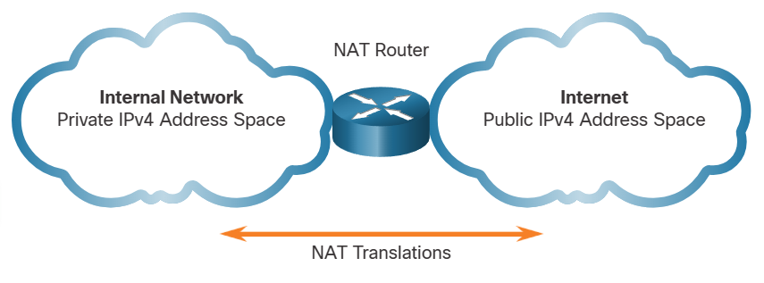
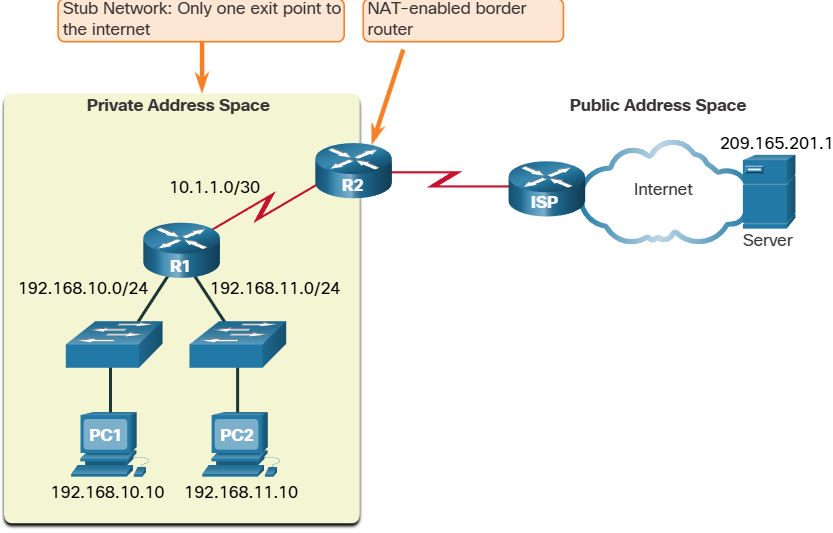

# NAT Characteristics
Network Address Translation (NAT) was developed due to the growing demand from the development of affordable desktop and laptop computers, smartphones, and etc.
  
NAT is designed to help manage those 4 billion addresses (IPv4) so that we can all use our many devices to access the internet.  

## IPv4 Private Address Space
There are not enough public IPv4 addresses to assign a unique address to each device connected to the internet.

### RFC 1918
|Class |RFC 1918 Internal Address Range| Prefix|
| --- | --- | --- |
|A | 10.0.0.0 - 10.255.255.255 | 10.0.0.0/8|
| B | 172.16.0.0 - 172.31.255.255 | 172.16.0.0/12 |
| C | 192.168.0.0 - 192.168.255.255 | 192.168.0.0/16 |

## What is NAT
NAT's primary use is to conserve public IPv4 addresses. It does this by allowing networks to use private IPv4 addresses internally and providing translation to a public address only when needed.
  

Perceived benefits of NAT:
* Adds a degree of privacy and security to a network -
* It hides internal IPv4 addresses from outside networks.
  

A NAT router typically operates at the border of a stub network.
A stub network is one or more networks with a single connection to its neighboring network, one way in and one way out of the network.

## NAT Terminology
The inside network is the set of networks that is subject to translation.
NAT includes four types of addresses:
* Inside local address
* Inside global address
* Outside local address
* Outside global address

When determining which type of address is used, it is important to remember that NAT terminology is always applied from the perspective of the device with the translated address:
* **Inside address** - The address of the device which is being translated by NAT.
* **Outside address** - The address of the destination device.

NAT also uses the concept of local or global with respect to addresses:
* **Local address** - A local address is any address that appears on the inside portion of the network.
* **Global address** - A global address is any address that appears on the outside portion of the network.

