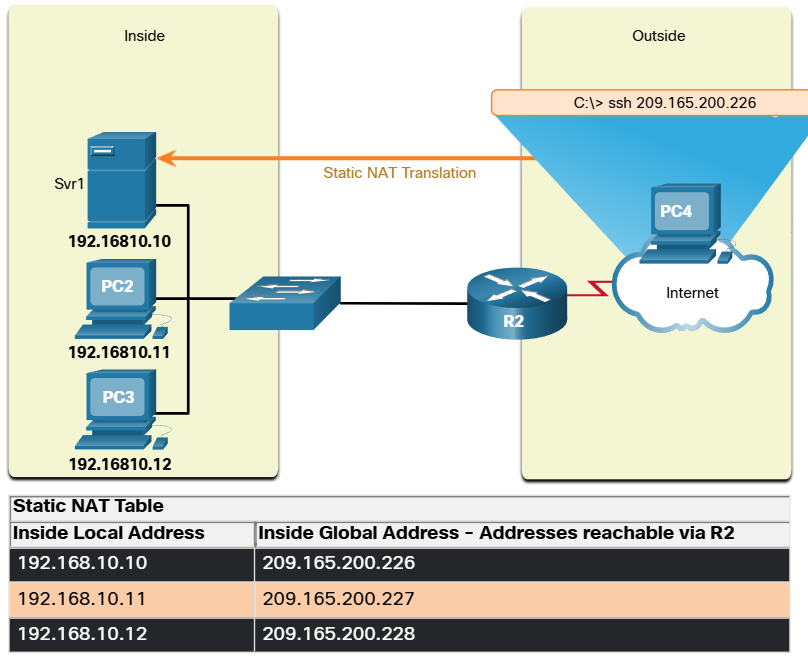

# Types of NAT

## Static NAT
Static NAT uses a one-to-one mapping of local and global addresses. These mappings are configured by the network administrator and remain constant.

Static NAT is particularly useful for web servers or devices that must have a consistent address that is accessible from the internet, such as a company web server.

*Simple explanation is that each address of the NAT table has their own dedicated public address*

For example, a network administrator from PC4 can use SSH to gain access to the inside global address of Svr1 (209.165.200.226). R2 translates this inside global address to the inside local address 192.168.10.10 and connects the session to Svr1.

## Port Address Translation
This is also known as NAT overload, maps multiple private IPv4 addresses to a *single* public IPv4 address or a few addresses. This is what most home routers do.
The ISP assigns one address to the router, yet several members of the household can simulataneously access the internet.

With PAT, multiple addresses can be mapped to one or to a few addresses, because each private address is also tracked by a port number.

When a device initiates a TCP/IP session, it generates a TCP or UDP source port value, or a specially assigned query ID for ICMP, to uniquely identify the session. *When the NAT router receives a packet from the client, it uses its soruce port number to uniquely identify the specific NAT translation.*

`192.168.10.10:1555`
- "192.168.10.10" is the local inside address.
- ":1555" is the port used to identify which device the NAT is going to translate.

## Next Available Port
PAT attempts to preserve the original source port. However, if the original source port is already used, PAT assigns the first available port number starting from the beginning of the appropriate port group 0-511, 512-1023, or 1024-65535.

When there are no more ports available and there is more than one external address in the address pool, PAT moves to the next address to try to allocate the original source port. This process continues until there are no more available ports orexternal IPv4 addresses.

## NAT and PAT comparison
| NAT | PAT |
| --- | --- |
| One-to-one mapping between Inside Local and Inside Global addresses. |  One Inside Global address can be mapped to many Inside Local addresses. |
| Uses only IPv4 addresses in translation process. | Uses IPv4 addresses and TCP or UDP source port numbers in translation process. |
| A unique Inside Global address is required for each inside host accessing the outside network. | A single unique Inside Global address can be shared by many inside hosts accessing the outside network. |

### NAT
NAT forwards the incoming return packets to the original inside host by referring to the table and translating the inside Global address back to the corresponding Inside Local address of the host.

| Inside Global Address | Inside Local Address |
| --- | --- |
| 209.165.200.226 | 192.168.10.10 |
| 209.165.200.227 | 192.168.10.11 |
| 209.165.200.228 | 192.168.10.12 |
| 209.165.200.229 | 192.168.10.13 |

### PAT
With PAT, there is generally only one, or very few, publicly exposed IPv4 addresses.

| Inside Global Address | Inside Local Address |
| --- | --- |
| 192.168.10.10:2031 | 209.165.200.226:2031 |
| 192.168.10.11:1506 | 209.165.200.226:1506 |
| 192.168.10.12:1131 | 209.165.200.226:1131 |
| 192.168.10.13:1718 | 209.165.200.226:1718 |

## Packets without a Layer 4 Segment
PAT normally uses TCP or UDP port numbers to identify different connections. However, some IPv4 protocols, like ICMPv4, do not use port numbers.

Instead, PAT uses the ICMP Query ID as a substitute for the port number.
- An ICMP Echo Request (ping) contains a Query ID.
- The corresponding Echo Reply uses the same Query ID.
- PAT uses this ID to identify and track which request belongs to which reply.

* Quick Reminder
    - TCP/UDP → PAT uses port numbers.
    - ICMPv4 → PAT uses the Query ID instead of port numbers.