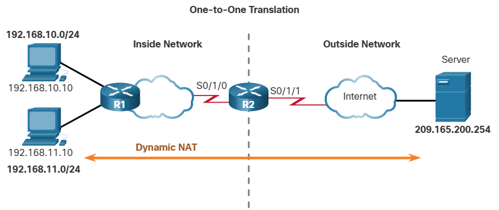

# Dynamic NAT

## Configure Dynamic NAT
The host inside local addresses are translated to an available pool address in the range of 209.165.200.226 to209.165.200.240.



### STEP 1
Define the pool of addresses that will be used for translation using the ip nat pool command. This pool of addresses is typically a group of public addresses. The addresses are defined by indicating the starting IPv4 address and the ending IPv4 address of the pool. The netmask or prefix-length keyword indicates which address bits belong to the network and which bits belong to the host for that range of addresses.

``` text
R2(config)# ip nat pool NAT-POOL1 209.165.200.226 209.165.200.240 netmask 255.255.255.224
```

### STEP 2
Configure a standard ACL to identify (permit) only those addresses that are to be translated. An ACL that is too permissive can lead to unpredictable results. Remember there is an implicit deny all statement at the end of each ACL.

``` text
R2(config)# access-list 1 permit 192.168.0.0 0.0.255.255
```

### STEP 3
Bind the ACL to the pool, using the following command syntax:
`Router(config)# ip nat inside source list {access-list-number | access-list-name} pool pool-name`

This configuration is used by the router to identify which devices (list) receive which addresses (pool).

``` text
R2(config)# ip nat inside source list 1 pool NAT-POOL1
```

### STEP 4
Identify which interfaces are inside, in relation to NAT; this will be any interface that connects to the inside network.

``` text
R2(config)# interface serial 0/1/0
R2(config-if)# ip nat inside
```

### STEP 5
Identify which interfaces are outside, in relation to NAT; this will be any interface that connects to the outside network.

``` text
R2(config)# interface serial 0/1/1
R2(config-if)# ip nat outside
```

## Verify Dynamic NAT
The output of the `show ip nat translations` command displays all static translations that have been configured and any dynamic translations that have been created by traffic.

``` text
R2# show ip nat translation verbose
```

Adding the verbose keyword displays additional information about each translation, including how long ago the entry was created and used.

By default, translation entries time out after 24 hours, unless the timers have been reconfigured with the `ip nat translation timeout timeout-seconds` command in global configuration mode.

To clear dynamic entries before the timeout has expired, use the `clear ip nat translation` privileged EXEC mode command as shown.
*Basically, clearing NAT cache*

``` text
R2# clear ip nat translation *
R2# show ip nat translation
```