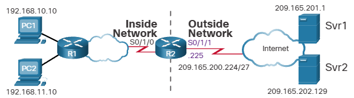
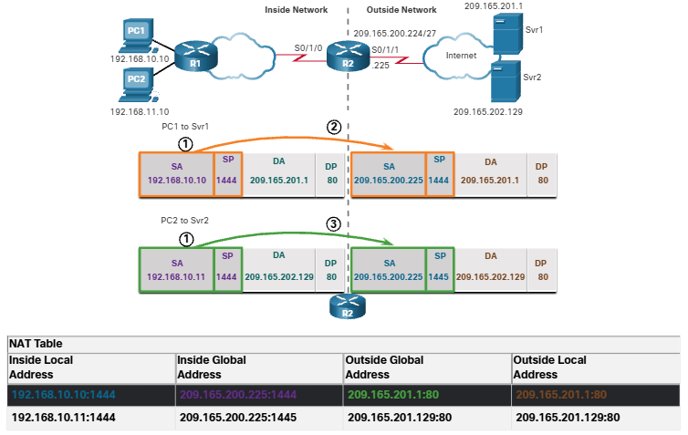

# PAT 

## Configure PAT to Use a Single IPv4 Address
To configure PAT to use a single IPv4 address, simply add the keyword overload to the ip nat inside source command. The rest of the configuration is the similar to static and dynamic NAT configuration except that with PAT, multiple hosts can use the same public IPv4 address to access the internet.

In the example, all hosts from network 192.168.0.0/16 (matching ACL 1) that send traffic through router R2 to the internet will be translated to IPv4 address 209.165.200.225 (IPv4 address of interface S0/1/1). The traffic flows will be identified by port numbers in the NAT table because the overload keyword is configured.

``` text
R2(config)# ip nat inside source list 1 interface serial 0/1/1 overload
R2(config)# access-list 1 permit 192.168.0.0 0.0.255.255
R2(config)# interface serial0/1/0
R2(config-if)# ip nat inside
R2(config-if)# exit
R2(config)# interface Serial0/1/1
R2(config-if)# ip nat outside
```

## Configure PAT to Use an Address Pool
An ISP may allocate more than one public IPv4 address to an organization. In this scenario the organization can configure PAT to use a pool of IPv4 public addresses for translation.


In the example, NAT-POOL2 is bound to an ACL to permit 192.168.0.0/16 to be translated. These hosts can share an IPv4 address from the pool because PAT is enabled with the keyword overload.

``` text
R2(config)# ip nat pool NAT-POOL2 209.165.200.226 209.165.200.240 netmask 255.255.255.224
R2(config)# access-list 1 permit 192.168.0.0 0.0.255.255
R2(config)# ip nat inside source list 1 pool NAT-POOL2 overload
R2(config)#
R2(config)# interface serial0/1/0
R2(config-if)# ip nat inside
R2(config-if)# exit
R2(config)# interface serial0/1/1
R2(config-if)# ip nat outside
R2(config-if)# end
R2#
```

## Analyze PAT - PC to Server


In this figure, PAT is configured to use a single public IPv4 address, instead of a pool of addresses. PC1 wants to communicate with the web server, Svr1. At the same time another client, PC2, wants to establish a similar session with the web server Svr2. Both PC1 and PC2 are configured with private IPv4 addresses, with R2 enabled for PAT.

*Basically, if two clients are requesting the same service with the same port, the port uses overload and increments the port address used.*

## Verify PAT
Router R2 has been configured to provide PAT to the 192.168.0.0/16 clients. When the internal hosts exit router R2 to the internet, they are translated to an IPv4 address from the PAT pool with a unique source port number.

``` text
R2# show ip nat translations
  Pro Inside global          Inside local         Outside local      Outside global
  tcp 209.165.200.225:1444  192.168.10.10:1444  209.165.201.1:80   209.165.201.1:80
  tcp 209.165.200.225:1445  192.168.11.10:1444  209.165.202.129:80 209.165.202.129:80
R2#
```

The `show ip nat statistics` command verifies that NAT-POOL2 has allocated a single address for both translations. Included in the output is information about the number and type of active translations, NAT configuration parameters, the number of addresses in the pool, and how many have been allocated.

``` text
R2# show ip nat statistics
Total active translations: 4 (0 static, 2 dynamic; 2 extended)
Peak translations: 2, occurred 00:31:43 ago
Outside interfaces:
  Serial0/1/1
Inside interfaces:
  Serial0/1/0
Hits: 4  Misses: 0
CEF Translated packets: 47, CEF Punted packets: 0
Expired translations: 0
Dynamic mappings:
-- Inside Source
[Id: 3] access-list 1 pool NAT-POOL2 refcount 2
  pool NAT-POOL2: netmask 255.255.255.224
      start 209.165.200.225 end 209.165.200.240
      type generic, total addresses 15, allocated 1 (6%), misses 0
(output omitted)
R2#
```

