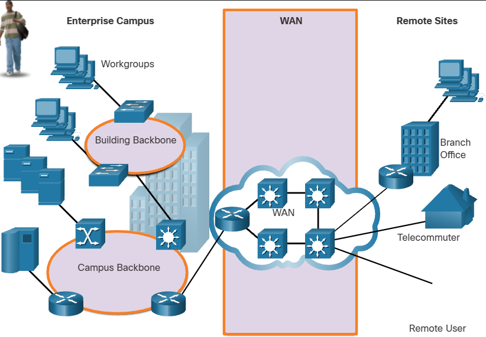
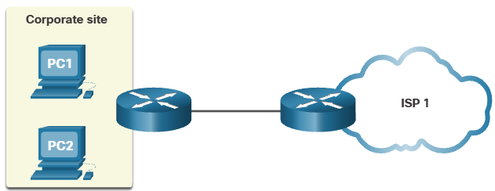
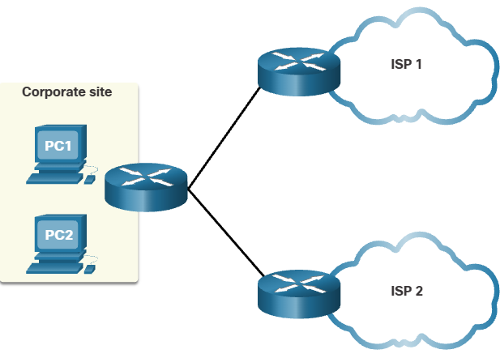
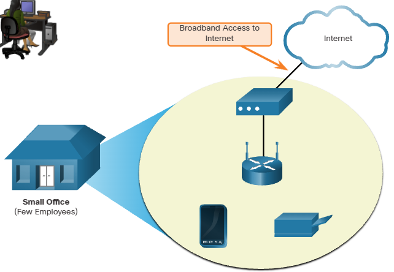

# LANs and WANs

LANs are limited to a small geographical area.
A Wide Area Network (WAN) is required to connect beyond the boundary of the LAN. A WAN is a telecommunications network the spans over a relatively large geographical area. 

**LANs vs WANs**

### Local Area Networks (LANs)
- LANs provide networking services within a small geographic area (i.e., home network, office network, building network, or campus network).
- LANs are used to interconnect local computers, peripherals, and other devices.
- A LAN is owned and managed by an organization or home user.
- Other than the network infrastructure costs, there is no fee to use a LAN.
- LANs provide high bandwidth speeds using wired Ethernet and Wi-Fi services.

### Wide Area Networks (WANs)
- WANs provide networking services over large geographical areas (i.e., in and between cities, countries, and continents).
- WANs are used to interconnect remote users, networks, and sites.
- WANs are owned and managed by internet service, telephone, cable, and satellite providers.
- WAN services are provided for a fee.
- WANs providers offer low to high bandwidth speeds, over long distances using complex physical networks.

## Private and Public WANs
WANS may be built by a variety of different types of organizations, as follows:
- An organization that wants to connect users in different locations
- An ISP that wants to connect customers to the internet
- An ISP or telecommunications that wants to interconnect ISPs

**A private WAN is a connection that is dedicated to a single customer.** This provides for the following:
- Guaranteed service level
- Consistent Bandwidth
- Security

## WAN Topologies
Physical topologies describe the physical infrastructure used by data when it is travelling from a source to a destination. The physical WAN topology used in WANs is complex and for the most part, unknown to users.

WAN topologies are described using a logical topology. Logical topologies describe the virtual connection between the source and destination.

1. **Point-to-Point Topology**
    - This employs a point-to-point circuit between two endpoints.
    - Point-to-point links often involve dedicated, leased-line connections from the corporate edge point to the provider networks. A point-to-point connection involves a Layer 2 transport service through the service provider network. Packets sent from one site are delivered to the other site and vice versa. A point-to-point connection is transparent to the customer network. It seems as if there is a direct physical link between two endpoints.
2. **Hub-and-Spoke Topology**
    - A hub-and-spoke topology enables a single interface on the hub router to be shared by all spoke circuits. Spoke routers can be interconnected through the hub router using virtual circuits and routed subinterfaces.
    - A hub-and-spoke topology is a single-homed topology. There is only one hub router and all communication must go through it. Therefore, spoke routers can only communicate with each other through the hub router. Consequently, the hub router represents a single point of failure. If it fails, inter-spoke communication also fails.
3. **Dual-horned Topology**
    - A dual-horned topology provides redundancy.
    - The advantage of dual-horned topology is that they offer enehanced network redundancy, load balancing, distributed computing and processing, and the ability to implement backup service provider connections.
    - The disadvantage is that they are more expensive to implement than singe-horned topologies. Because they require additional networking hardware, such as additional routers and switches. They are also more difficult to implement because they require additional, and more complex, configurations.
4. **Fully Meshed Topology**
    - A fully meshed topology uses multiple virtual circuits to connect all sites, as shown in the figure.
    - This is the most fault-tolerant topology of the five.
5. **Partially Meshed Topology**
    - Connnects many but not all sites. For example, sites A, B, C are still fully meshed while site D must connect to site A to reach the other sites.

## Carrier Connections
Another aspect of WAN design is how an organization connects to the internet. An organization usually signs a service level agreement (SLA) with a service provider. The SLA outlines the expected services relating to the reliability and availability of the connection. 

The service provider may or may not be the actual carrier. A carrier owns and maintains the physical connection and equipment between the provider and the customer. Typically, an organization will choose either a single-carrier or dual-carrier WAN connection.

### Single-Carrier WAN Connection

When an organization connects to only one service provider, as shown in the figure. A Service Level Agreement (SLA) is negotiated between the organization and the service provider. The disadvantage of this design is the carrier connection and service provider are both *single points of failure*. Connectivity to the internet would be lost if the carrier link or the provider router failed.

### Dual-Carrier WAN Connection

This carrier connection provides redundancy and increases network availability, as shown in the figure. The organization negotiates separate SLAs with two different service providers. The organization should ensure that the two providers each use a different carrier. Although more expensive to implement, the second connection can be used for redundancy as a backup link. It could also be used to improve network performance and load balance internet traffic.

## Evolving Networks
Network requirements of a company can change dramatically as the company grows over time. Distributing employees saves costs in many ways, but it puts increased demands on the network. Not only must a network meet the day-to-day operational needs of the business, but it must be able to adapt and grow as the company changes. 

To illustrate differences between network size, we will use a fictitious company called SPAN Engineering as it grows from a small, local, business into a global enterprise.

### 1. Small Network
The company initially consisted of 15 employees working in a small office, as shown in the figure.

They used a single LAN that was connected to a wireless router for sharing data and peripherals. The connection to the internet is through a common broadband service called Digital Subscriber Line (DSL), which is supplied by their local telephone service provider. To support their IT requirements, they contracted services from the DSL provider.

### 2. Campus Network
Within a few years, the company grew and required several floors of a building, as shown in the figure.

The company now required a Campus Area Network (CAN). A CAN interconnects several LANs within a limited geographical area. Multiple LANs are required to segment the various departments that are connecting to multiple switches in a campus network environment.

The network includes dedicated servers for email, data transfer, and file storage, and web-based productivity tools and applications. A firewall secures internet access to corporate users. The business now requires in-house IT staff to support and maintain the network.