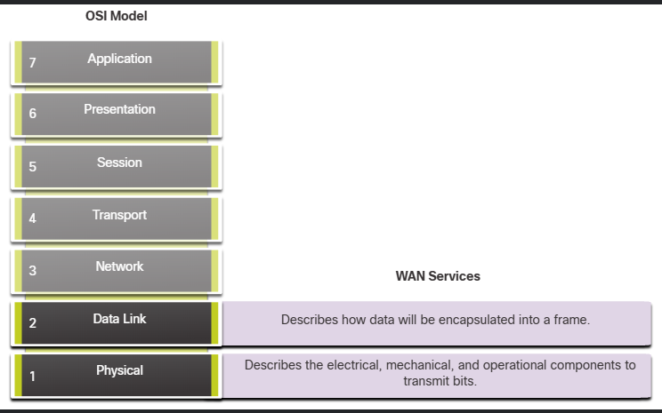
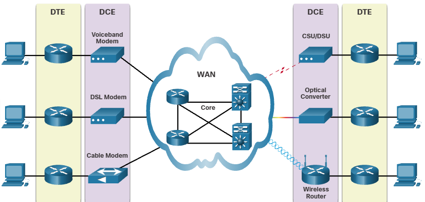

# WAN Operations

## WAN Standards
The concept of a WAN has been around for many years. Consider that the telegraph system was the first large-scale WAN, followed by radio, telephone system, television, and now data networks. Many of the technologies and standards developed for theses WANs used as the basis for network WANs.

Modern WAN standards are defined and managed by a number of recognized authorities including the following:
- **TIA/EIA** - Telecommunications Industry Association and Electronic Industries Alliance
- **ISO** - International Organization for Standardization
- **IEEE** - Institute of Electrical and Electronics Engineers

## WANS in the OSI Model
Most WAN standards focus on the physical layer (OSI Layer 1) and the data link layer (OSI Layer 2), as shown in the figure.

### LAYER 1 PROTOCOLS
Describes the electrical, mechanical, operational components needede to transmit bits over a WAN. For example, service providers commonly use high-bandwidth optical fiber media to span long distances (i.e, long haul) using the following Layer 1 optical fiber protocol standards: 
- Synchronous Digital Hierarchy (SDH)
- Synchronous Optical Networking (SONET)
- Dense Wavelength Division Multiplexing (DWDM)

SDH and SONET essentially provide the same services and their transmission capacity can be increased by using DWDM technology.

### LAYER 2 PROTOCOLS
This layer defines how data will be encapsulated into a frame. 
Several layer 2 protocols have evolved over the years including the following:
- Broadband (i.e., DSL and Cable)
- Wireless
- Ethernet WAN (Metro Ethernet)
- Multiprotocol Label Switching (MPLS)
- Point-to-Point Protocol (PPP) (less used)
- High-Level Data Link Control (HDLC) (less used)
- Frame Relay (legacy)
- Asynchronous Transfer Mode (ATM) (legacy)

## Common WAN Terminology
The WAN physical layer describes the physical connections between the company network and the service provider network.
These are specific terms used to describe WAN connections between the subscriber (i.e, the company / client) and the WAN service provide.

* **Data Terminal Equipment (DTE)**
    - This is the device that connects the subscriber LANs to the WAN communication device (i.e., DCE).
    - Inside hosts send their traffic to the DTE device.
    - The DTE connects to the local loop through the DCE.
    - The DTE device is usually a router but could be a host or server.
* **Data Communications Equipment (DCE)**
    - Also called data circuit-terminating equipment, this is the device used to communicate with the provider.
    - The DCE primarily provides an interface to connect subscribers to a communication link on the WAN cloud.
* **Customer Premises Equipment (CPE)**
    - This is the DTE and DCE devices (i.e., router, modem, optical converter) located on the enterprise edge.
    - The subscriber either owns the CPE or leases the CPE from the service provider.
* **Point-of-Presence (POP)**
    - This is the point where the subscriber connects to the service provider network.
* **Demarcation Point**
    - This is a physical location in a building or complex that officially separates the CPE from service provider equipment.
    - The demarcation point is typically a cabling junction box, located on the customer premises, that connects the CPE wiring to the local loop
    - It identifies the location where the network operation responsibility changes from the subscriber to the service provider.
    - When problems arise, it is necessary to determine whether the user or the service provider is responsible for troubleshooting or repair.
* **Local Loop (or last mile)**
    - This is the actual copper or fiber cable that connects the CPE to the CO of the service provider.
* **Central Office (CO)**
    - This is the local service provider facility or building that connects the CPE to the provider network.
* **Toll network**
    - This includes backhaul, long-haul, all-digital, fiber-optic communications lines, switches, routers, and other equipment inside the WAN provider network.
* **Backhaul network**
    - (Not shown) Backhaul networks connect multiple access nodes of the service provider network.
    - Backhaul networks can span over municipalities, countries and regions.
    - Backhaul networks are also connected to internet service providers and to the backbone network.
* **Backbone network**
    - (Not shown) These are large, high-capacity networks used to interconnect service provider networks and to create a redundant network.
    - Other service providers can connect to the backbone directly or through another service provider.
    - Backbone network service providers are also called Tier-1 providers. 

## WAN Devices
The end-to-end data path over a WAN is usually from the source DTE to the DCE, then to the WAN cloud, then to the DCE to and finally to the destination DTE, as shown in the figure.

* **Voiceband Modem**
    - Also known as dial-up modem.
    - Legacy device that converted (i.e., modulated) the digital signals produced by a computer into analog voice frequencies.
    - Uses telephone lines to transmit
* **DSL Modem and Cable Modem**
    - Collectively known as broadband modems, these high-spReed digital modems connect to the DTE router using Ethernet.
    - DSL modems connect to the WAN using telephone lines.
    - Cable modems connect to the WAN using coaxial lines.
    - Both operate in a similar manner to the voiceband modem but use higher broadband frequencies and transmission speeds.
* **CSU/DSU**
    - Digital-leased lines require a CSU and a DSU.
    - It connects a digital device to a digital line.
    - A CSU/DSU can be a separate device like a modem or it can be an interface on a router.
    - The CSU provides termination for the digital signal and ensures connection integrity through error correction and line monitoring.
    - The DSU converts the line frames into frames that the LAN can interpret and vice versa.
* **Optical Converter**
    - Also known as an optical fiber converter.
    - These devices connect fiber-optic media to copper media and convert optical signals to electronic pulses.
* **Wireless Router or Access Point**
    - Devices are used to wirelessly connect to a WAN provider.
    - Routers could also use cellular wireless connectivity.
* **WAN Core devices**
    - The WAN backbone consists of multiple high-speed routers and Layer 3 switches.
    - A router or multilayer switch must be able to support multiple telecommunications interfaces of the highest speed used in the WAN core.
    - It must also be able to forward IP packets at full speed on all those interfaces.
    - The router or multilayer switch must also support the routing protocols being used in the core.

## Serial Communication
Almost all network communications occur using a serial communication delivery. Serial Communication transmits bits sequentially over a single channel. In contrast, parallel communications simultaneously transmit several bits using multiple wires.

Although a parallel connection theoretically transfers data eight times faster than a serial connection, it is prone to synchronization problems. As the cable length increases, the synchronization timing between multiple channels becomes more sensitive to distance. For this reason, parallel communication is limited to very short distances only (e.g., copper media is limited to less than 8 meters (i.e., 26 feet).

Therefore, parallel communication is not a viable WAN communication method because of its length restriction. It is however a viable solution in data centers where distances between servers and switches are relatively short.

## Circuit-Switched Communication
Network communication can be implemented using circuit-switched communication. This network establishes a dedicated circuit (or channel) between endpoints before the users can communicate.

Circuit switching establishes a dedicated connection (circuit) through a service provider's network before communication begins.

Example: When making a landline call, the provider creates a dedicated path between the caller and the receiver.

All data travels through the same path for the entire connection.

The circuit's capacity is reserved even when no data is being sent, making it inefficient for data communication.

Common circuit-switched WANs: PSTN and ISDN.

## Packet-Switched Communications
Network communication is most commonly implemented using packet-switched communication. In contrast to circuit-switching, packet-switching segments traffic data into packets that are routed over a shared network. Packet-switched networks do not require a circuit to be established, and they allow many pairs of nodes to communicate over the same channel.

- **Packet switching** breaks data into packets that share network paths instead of using a dedicated connection.
- It is **cheaper and more flexible** than circuit switching.
- It may experience **latency (delay)** and **jitter (variation in delay)**, but modern technology can still support satisfactory voice and video communication.
- Common packet-switched WANs: Metro Ethernet, MPLS, Frame Relay, and ATM.

## SDH, SONET, and DWDM
Service provider networks use fiber-optic infrastructures to transport user data between destinations. Fiber-
optic cable is far superior to copper cable for long distance transmissions due to its much lower attenuation
and interference.

There are two optical fiber OSI layer 1 standards available to service providers:
- SDH - Synchronous Digital Hierarchy (SDH) is a global standard for transporting data over fiber-optic cable.
- SONET - Synchronous Optical Networking (SONET) is the North American standard that provides the same services as SDH.

Both standards are essentially the same and therefore, they are often listed as SONET/SDH.

SDH/SONET define how to transfer multiple data, voice, and video communications over optical fiber using lasers or light-emitting diodes (LEDs) over great distances. Both standards are used on the ring network topology that contains the redundant fiber paths that allow traffic to flow in both directions.

Dense Wavelength Division Multiplexing (DWDM) is a newer technology that increases the data-carrying capacity of SDH and SONET by simultaneously sending multiple streams of data (multiplexing) using different wavelengths of light, as shown in the figure.