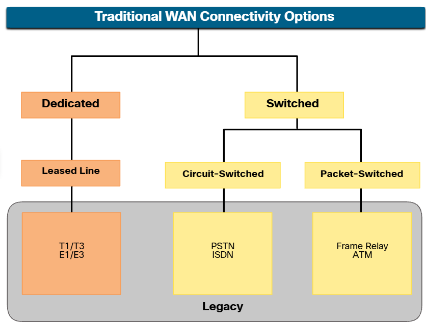

# Traditional WAN Connectivity

When LANs appeared in the 1980s, organizations began to see the need to interconnect with other locations. To do so, they needed their networks to connect to the local loop of a service provider. 
This was accomplished by using dedicated lines, or by using switched services from a service provider.

The figure summarizes the traditional WAN connectivity options.

## Common WAN Terminology
When permanent dedicated connections were required, a point-to-point link using copper media was used to provide a pre-established WAN communications path from the customer premises to the provider network. Point-to-point lines could be leased from a service provider and were called *"leased lines"*. The term refers to the fact that the organization pays a monthly lease fee to a service provider to use the line.

There are two systems used to define the digital capacity of a copper media serial link:
- **T-carrier** -Used in North America, T-carrier provides T1 links supporting bandwidth up to 1.544 Mbps and T3 links supporting bandwidth up to 43.7 Mbps.
- **E-carrier** - Used in Europe, E-carrier provides E1 links supporting bandwidth up to 2.048 Mbps and E3 links supporting bandwidth up to 34.368 Mbps.

*Note: The copper cable physical infrastructure has largely been replaced by optical fiber network.*

### Advantages and Disadvantages of leased lines
**ADVANTAGES**
1. Simplicity
    - Point-to-point communication links require minimal expertise to install and maintain.
2. Quality
    - Point-to-point communication links usually offer high quality service, if they have adequate bandwidth. The dedicated capacity removes latency or jitter between the endpoints.
3. Availability
    - Constant availability is essential for some applications, such as e-commerce. Point-to-point communication links provide permanent, dedicated capacity which is required for VolP or Video over IP.

**DISADVANTAGES**
1. Cost
    - Point-to-point links are generally the most expensive type of WAN access. The cost of leased line solutions can become significant when they are used to connect many sites over increasing distances. In addition, each endpoint requires an interface on the router, which increases equipment costs.
2. Limited flexibility
    - WAN traffic is often variable, and leased lines have a fixed capacity, so that the bandwidth of the line seldom matches the need exactly. Any change to the leased line generally requires a site visit by ISP personnel to adjust capacity.

## Circuit-Switched Options
Circuit-switched connections are provided by Public Service Telephone Network (PSTN) carriers. The local loop connecting the CPE to the CO is copper media.

### Public Service Telephone Network (PSTN)
Dialup WAN access uses the PSTN as its WAN connection. Traditional local loops can transport binary computer data through the voice telephone network using a voiceband modem. 

The modem modulates the digital data into an analog signal at the source and demodulates the analog signal to digital data at the destination. 

The physical characteristics of the local loop and its connection to the PSTN limit the rate of the signal to less than 56 kbps.

Dialup access is considered a legacy WAN technology. However, it may still be viable solution when no other WAN technology is available.

### Integrated Services Digital Network (ISDN)
ISDN is a circuit-switching technology that enables the PSTN local loop to carry digital signals. This provided higher capacity  witched connections than dialup access. ISDN provides for data rates from 45 Kbps to 2.048 Mbps.

ISDN has declined greatly in popularity due to high-speed DSL and other broadband services. ISDN is considered a legacy technology with most major providers discontinuing this service.

## Packet-Switched Options
Packet switching segments data into packets that are router over a shared network. Circuit-switched networks require a dedicated circuit to be established. In contrast, packet-switching networks allow many pairs of nodes to communicate over the same channel.

### Frame Relay
Is an older way of connecting a company's different office networks together.

Instead of needing a separate physical cable for every office, one router port can connect to multiple offices at once using virtual pathways called PVCs (Permanent Virtual Circuits).
Each pathway gets its own ID number (DLCI) so data knows which office to go to and come back from.
It can carry both voice and data at speeds usually up to 4 Mbps, though most companies have replaced it with faster internet and Metro Ethernet connections.

### Asynchronous Transfer Mode (ATM)
ATM (Asynchronous Transfer Mode) is an older networking technology that sends voice, video, and data by chopping everything into tiny, uniform pieces called cells (always 53 bytes long: 5 bytes of address/control info and 48 bytes of actual data).

Because every piece is small and the exact same size, voice and video don't get stuck waiting behind huge data downloads, preventing lag. However, slicing data into so many tiny pieces adds a lot of extra address labels (overhead), making ATM about 20% less efficient than Frame Relay which is why faster Metro Ethernet and modern internet connections have mostly replaced it.

